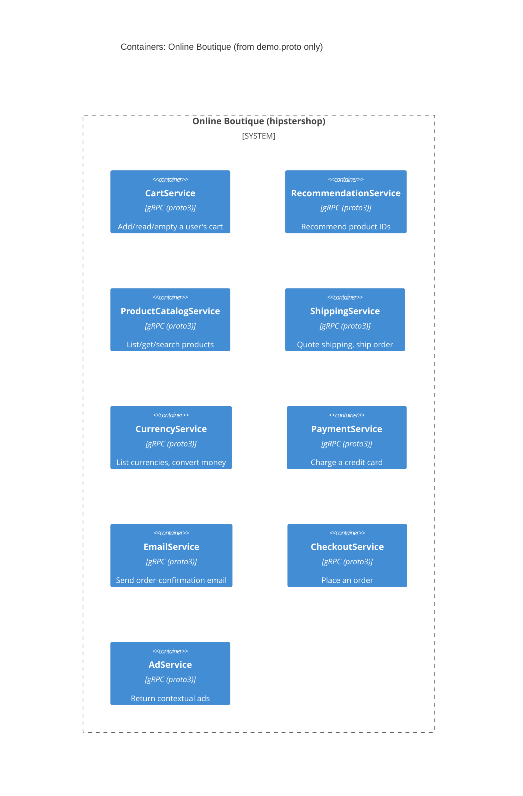

# Task 1 — Recover the architecture (run A)

## 1. Agent

- **Product:** Claude Code (Anthropic's official CLI for Claude)
- **Model:** Claude Opus 4.8 (`claude-opus-4-8`)

## 2. Files read

- `prompts/1-recover-architecture.md` (the task)
- `system/online-boutique/protos/demo.proto` (the only evidence)

## 3. Containers table

The evidence is a single gRPC interface definition (`syntax = "proto3"`, `package hipstershop`). It declares **9 services** as gRPC service definitions. The implementation language of each service is **not** evidenced; the only hint is the `option go_package` line (Go stubs), which proves nothing about each service's runtime.

| Container | Technology / Language | Responsibility | Evidence |
|---|---|---|---|
| CartService | gRPC (proto3) | Add an item to, read, and empty a user's cart | `demo.proto:23` (`service CartService`: `AddItem`, `GetCart`, `EmptyCart`) |
| RecommendationService | gRPC (proto3) | Return recommended product IDs for a user/product list | `demo.proto:56` (`service RecommendationService`: `ListRecommendations`) |
| ProductCatalogService | gRPC (proto3) | List, get and search products | `demo.proto:71` (`service ProductCatalogService`: `ListProducts`, `GetProduct`, `SearchProducts`) |
| ShippingService | gRPC (proto3) | Quote a shipping cost and ship an order | `demo.proto:107` (`service ShippingService`: `GetQuote`, `ShipOrder`) |
| CurrencyService | gRPC (proto3) | List supported currencies and convert money amounts | `demo.proto:140` (`service CurrencyService`: `GetSupportedCurrencies`, `Convert`) |
| PaymentService | gRPC (proto3) | Charge a credit card and return a transaction ID | `demo.proto:177` (`service PaymentService`: `Charge`) |
| EmailService | gRPC (proto3) | Send an order-confirmation email | `demo.proto:199` (`service EmailService`: `SendOrderConfirmation`) |
| CheckoutService | gRPC (proto3) | Place an order | `demo.proto:224` (`service CheckoutService`: `PlaceOrder`) |
| AdService | gRPC (proto3) | Return contextual ads for a set of keywords | `demo.proto:243` (`service AdService`: `GetAds`) |

No data store (`ContainerDb`) and no message broker (`ContainerQueue`) are evidenced in this file.

## 4. Dependencies table

**Not evidenced in the provided files.** `demo.proto` defines each service's RPC interface independently. It does **not** record any runtime call from one service to another, nor any caller outside the system, nor any protocol binding beyond "these are gRPC services." Shared message types (e.g. `CartItem`, `Money`, `Address`, `OrderResult`) hint at relationships, but reusing a message type is not evidence of a runtime call, so no dependency rows are listed here. Candidate (unprovable) relationships are recorded under **Gaps**.

| Caller → Callee | Protocol | Evidence |
|---|---|---|
| — | — | Not evidenced in the provided files |

## 5. Mermaid diagram

The diagram matches the tables exactly: the 9 evidenced services appear as `Container`s inside the system boundary. No `Person`, `System_Ext`, `ContainerDb`, `ContainerQueue` or `Rel` is drawn, because none is evidenced in `demo.proto`.

## 6. Gaps

| What I could not determine | File that would settle it |
|---|---|
| **Runtime dependencies between services.** The proto shows interfaces, not call graphs. The shared message types suggest, but do not prove, that CheckoutService orchestrates CartService, ProductCatalogService, CurrencyService, ShippingService, PaymentService and EmailService **[Inferred]**, and that a frontend calls most services. | Each service's source (e.g. `src/checkoutservice/`) or the per-service env vars in `kubernetes-manifests/*.yaml` (e.g. `CART_SERVICE_ADDR`, `PRODUCT_CATALOG_SERVICE_ADDR`) |
| **The end user / frontend.** No `Person` or UI is evidenced in the proto. | `src/frontend/` and `kubernetes-manifests/frontend.yaml` |
| **Data stores.** CartService's `AddItem`/`GetCart`/`EmptyCart` imply persistent cart state **[Inferred]**, but no store is evidenced. | `kubernetes-manifests/*.yaml` / `src/cartservice/` (e.g. a Redis dependency) |
| **Message broker.** No queue is evidenced. | `kubernetes-manifests/*.yaml` |
| **Implementation language per service.** Only `option go_package` (`demo.proto:19`) appears; it indicates generated Go stubs, not each service's runtime language. | `src/<service>/Dockerfile` or each service's source tree |
| **External systems** (e.g. a real payment provider). `PaymentService.Charge` exists but the proto shows no external call. | `src/paymentservice/` |
