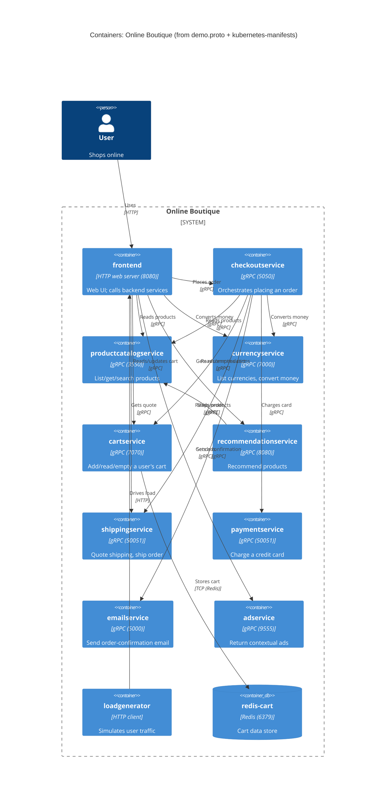

# Task 1 — Recover the architecture (run B)

## 1. Agent

- **Product:** Claude Code (Anthropic's official CLI for Claude)
- **Model:** Claude Opus 4.8 (`claude-opus-4-8`)

## 2. Files read

- `prompts/1-recover-architecture.md` (the task)
- `system/online-boutique/protos/demo.proto`
- `system/online-boutique/kubernetes-manifests/adservice.yaml`
- `system/online-boutique/kubernetes-manifests/cartservice.yaml`
- `system/online-boutique/kubernetes-manifests/checkoutservice.yaml`
- `system/online-boutique/kubernetes-manifests/currencyservice.yaml`
- `system/online-boutique/kubernetes-manifests/emailservice.yaml`
- `system/online-boutique/kubernetes-manifests/frontend.yaml`
- `system/online-boutique/kubernetes-manifests/loadgenerator.yaml`
- `system/online-boutique/kubernetes-manifests/paymentservice.yaml`
- `system/online-boutique/kubernetes-manifests/productcatalogservice.yaml`
- `system/online-boutique/kubernetes-manifests/recommendationservice.yaml`
- `system/online-boutique/kubernetes-manifests/shippingservice.yaml`
- `system/online-boutique/kubernetes-manifests/kustomization.yaml`
- `system/online-boutique/kubernetes-manifests/README.md`

## 3. Containers table

Each manifest is a Kubernetes `Deployment` + `Service`. "gRPC server" is evidenced by `grpc:` liveness/readiness probes and `grpc`-named service ports, together with the gRPC interfaces in `demo.proto`. The **implementation language** of each service is still **not** evidenced — the manifests only name an opaque `image:` (e.g. `image: frontend`), and the `kubernetes-manifests/README.md` says the tags are filled in later by `skaffold`.

| Container | Technology | Responsibility | Evidence |
|---|---|---|---|
| frontend | HTTP web server, port 8080 | Web UI; calls the backend services | `frontend.yaml:16,47-49` (`Deployment frontend`, `image: frontend`, `containerPort: 8080`, `/_healthz` HTTP probes) |
| productcatalogservice | gRPC server, port 3550 | List/get/search products | `productcatalogservice.yaml:46-48,55` (`image`, `containerPort: 3550`, grpc probe) |
| currencyservice | gRPC server, port 7000 | List currencies, convert money | `currencyservice.yaml:46-49,56` |
| cartservice | gRPC server, port 7070 | Add/read/empty a user's cart | `cartservice.yaml:46-48,61` |
| recommendationservice | gRPC server, port 8080 | Recommend products | `recommendationservice.yaml:46-48,51` |
| shippingservice | gRPC server, port 50051 | Quote shipping, ship order | `shippingservice.yaml:45-47,55` |
| checkoutservice | gRPC server, port 5050 | Orchestrate placing an order | `checkoutservice.yaml:45-47,49-50` |
| paymentservice | gRPC server, port 50051 | Charge a credit card | `paymentservice.yaml:46-48,55` |
| emailservice | gRPC server, container 8080 / service port 5000 | Send order-confirmation email | `emailservice.yaml:46-48,56,82-83` |
| adservice | gRPC server, port 9555 | Return contextual ads | `adservice.yaml:46-48,62` |
| loadgenerator | Load generator (HTTP client) | Simulates user traffic against the frontend | `loadgenerator.yaml:17,80-83` (`image: loadgenerator`, `FRONTEND_ADDR=frontend:80`) |
| redis-cart | Redis (`redis:alpine`) data store, port 6379 | Persists cart data for cartservice | `cartservice.yaml:92,118-120,129-131` (`Deployment redis-cart`, `image: redis:alpine`, `/data` volume) |

## 4. Dependencies table

Each row is evidenced by a `*_SERVICE_ADDR` / `REDIS_ADDR` / `FRONTEND_ADDR` environment variable in the **caller's** manifest (which names the callee's in-cluster host:port), or by a Kubernetes `Service` that exposes the callee. The target's `grpc`-named port / grpc probe confirms the protocol.

| Caller → Callee | Protocol | Evidence (file · symbol) |
|---|---|---|
| User → frontend | HTTP | `frontend.yaml:123-136` (`Service frontend-external`, `type: LoadBalancer`, port 80 → 8080) |
| loadgenerator → frontend | HTTP | `loadgenerator.yaml:82-83` (`FRONTEND_ADDR=frontend:80`) |
| frontend → productcatalogservice | gRPC | `frontend.yaml:69-70` (`PRODUCT_CATALOG_SERVICE_ADDR=productcatalogservice:3550`) |
| frontend → currencyservice | gRPC | `frontend.yaml:71-72` (`CURRENCY_SERVICE_ADDR=currencyservice:7000`) |
| frontend → cartservice | gRPC | `frontend.yaml:73-74` (`CART_SERVICE_ADDR=cartservice:7070`) |
| frontend → recommendationservice | gRPC | `frontend.yaml:75-76` (`RECOMMENDATION_SERVICE_ADDR=recommendationservice:8080`) |
| frontend → shippingservice | gRPC | `frontend.yaml:77-78` (`SHIPPING_SERVICE_ADDR=shippingservice:50051`) |
| frontend → checkoutservice | gRPC | `frontend.yaml:79-80` (`CHECKOUT_SERVICE_ADDR=checkoutservice:5050`) |
| frontend → adservice | gRPC | `frontend.yaml:81-82` (`AD_SERVICE_ADDR=adservice:9555`) |
| checkoutservice → productcatalogservice | gRPC | `checkoutservice.yaml:57-58` (`PRODUCT_CATALOG_SERVICE_ADDR`) |
| checkoutservice → shippingservice | gRPC | `checkoutservice.yaml:59-60` (`SHIPPING_SERVICE_ADDR`) |
| checkoutservice → paymentservice | gRPC | `checkoutservice.yaml:61-62` (`PAYMENT_SERVICE_ADDR`) |
| checkoutservice → emailservice | gRPC | `checkoutservice.yaml:63-64` (`EMAIL_SERVICE_ADDR=emailservice:5000`) |
| checkoutservice → currencyservice | gRPC | `checkoutservice.yaml:65-66` (`CURRENCY_SERVICE_ADDR`) |
| checkoutservice → cartservice | gRPC | `checkoutservice.yaml:67-68` (`CART_SERVICE_ADDR`) |
| recommendationservice → productcatalogservice | gRPC | `recommendationservice.yaml:60-61` (`PRODUCT_CATALOG_SERVICE_ADDR`) |
| cartservice → redis-cart | TCP (Redis) | `cartservice.yaml:50-51` (`REDIS_ADDR=redis-cart:6379`) |

## 5. Mermaid diagram

## 6. Gaps

| What I could not determine | File that would settle it |
|---|---|
| **Implementation language per service.** Manifests only give opaque `image:` names; `kubernetes-manifests/README.md` says tags are filled by `skaffold`. | Each service's `src/<service>/Dockerfile` or source tree |
| **`shoppingassistantservice`** is referenced by `frontend.yaml:83-84` (`SHOPPING_ASSISTANT_SERVICE_ADDR=shoppingassistantservice:80`) but **no Deployment/Service exists** for it in these manifests, and it is not in `kustomization.yaml`. It is likely an optional component **[Inferred]**; I did not draw it. | A `shoppingassistantservice.yaml` manifest or the `kustomize/components/shopping-assistant` component |
| **Direction/protocol are inferred for the `User` edge.** The `frontend-external` `LoadBalancer` proves external exposure on port 80 (HTTP), but the manifests don't confirm HTTPS/a real end user. | An Ingress/Gateway manifest or `src/frontend` |
| **Call protocols are inferred from ports/probes.** `*_SERVICE_ADDR` proves the dependency exists; "gRPC" comes from the callee's grpc probe + `demo.proto`. The frontend→checkout etc. calls could in principle differ. | The caller's source (e.g. `src/frontend/main.go`, `src/checkoutservice/main.go`) |
| **adservice has no outgoing dependencies** in its manifest — consistent with a leaf service, but unproven beyond "no env vars". | `src/adservice/` |
| **emailservice port mismatch** (container 8080, Service port 5000). Matches `checkoutservice`'s `EMAIL_SERVICE_ADDR=emailservice:5000`, so the Service port is the one used — noted for clarity. | — (resolved by the manifests) |
